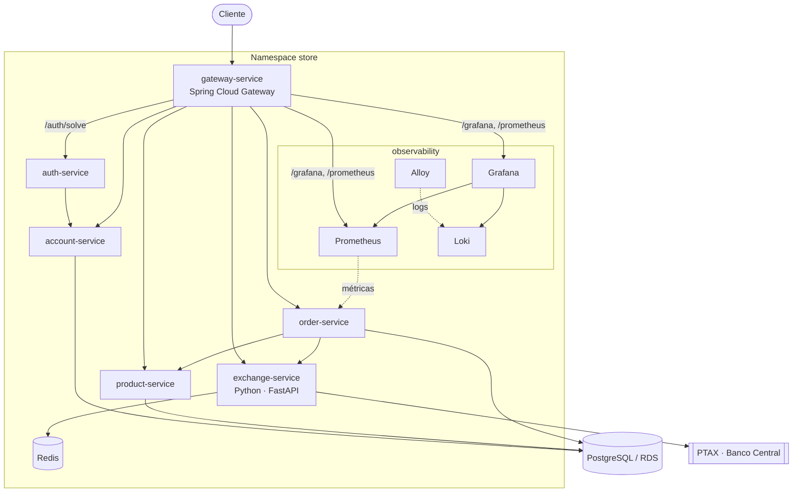
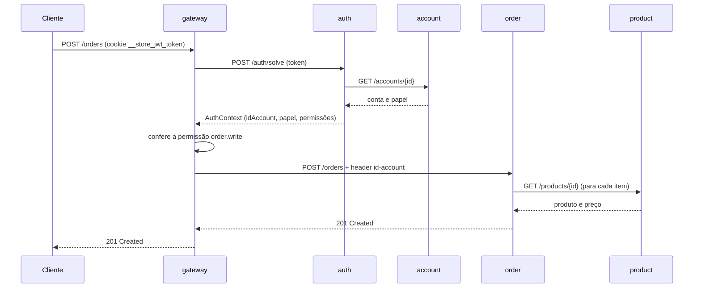

# Arquitetura

Toda requisição externa entra pelo **gateway**, o único componente exposto. Ele
autentica o usuário, aplica as permissões da rota e encaminha a chamada ao
serviço de destino pela rede interna. Os serviços se falam por HTTP síncrono
(OpenFeign), usando os contratos publicados por cada um.

## Fluxo de uma requisição autenticada

## Decisões de arquitetura

| Decisão | Motivo |
| --- | --- |
| Contrato separado da implementação | Quem consome um serviço depende só da interface Feign e dos DTOs, não do código interno. |
| Gateway como porta única | Autenticação e autorização ficam em um só lugar; os serviços confiam no header `id-account`. |
| Papel resolvido a cada requisição | O JWT não carrega o papel: uma troca de papel vale na hora, ao custo de uma chamada extra ao auth. |
| Um schema por serviço (`accounts`, `products`, `orders`) | Cada serviço controla suas tabelas com Flyway, mesmo compartilhando a instância de banco. |
| Valores dos pedidos em USD | A moeda de armazenamento é fixa; a conversão acontece só na leitura, pelo exchange. |
| Observabilidade em repositório próprio | Os serviços entram na coleta com labels (Compose) ou anotações (Kubernetes), sem alterar a stack. |
