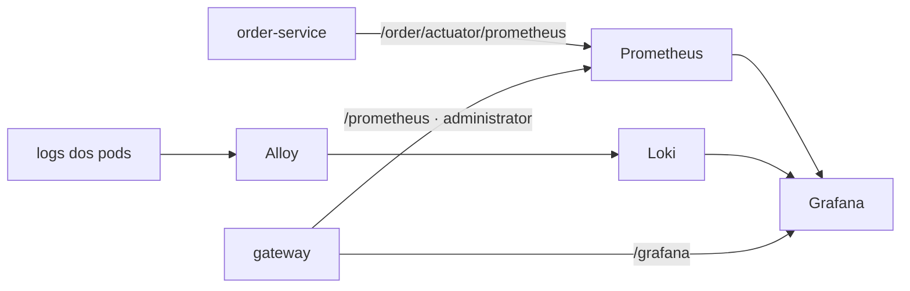

# Bottlenecks

Três dos gargalos propostos pela disciplina foram implementados, um por
integrante.

## Observabilidade

*Responsável: Luísa Carvalho Farah · repositório
[observability](https://github.com/organizacao-do-sucesso/observability)*

**Problema.** Com seis serviços conversando entre si, uma requisição lenta ou com
erro pode ter origem em qualquer um deles, e os logs ficam espalhados por vários
contêineres.

**Solução.** Uma stack compartilhada, em repositório próprio, com três sinais:

| Componente | Papel |
| --- | --- |
| Prometheus | Coleta métricas dos serviços a cada 15 s |
| Alloy → Loki | Coleta os logs dos contêineres e os armazena com as labels `service` e `level` |
| Grafana | Dashboard *Store - Services* com taxa de requisições, erros 5xx, latência p95, chamadas Feign, pedidos, JVM e logs |

**Decisões.**

- **Os serviços entram na coleta sem alterar a stack.** No Docker Compose, com
  labels (`prometheus.scrape`, `prometheus.port`, `prometheus.path`); no
  Kubernetes, com anotações `prometheus.io/*` no pod. O Prometheus descobre os
  alvos sozinho, pelo socket do Docker ou pela API do Kubernetes.
- **Logs estruturados.** O order-service escreve logs em JSON (formato ECS), e o
  Alloy transforma o nível do log em label, o que permite filtrar erros no
  Grafana.
- **Acesso só pelo gateway.** Nenhuma porta é publicada. O Grafana fica em
  `/grafana/` com o login próprio; o Prometheus, que não tem autenticação, fica
  em `/prometheus/` e exige o papel `administrator`.
- **Latência em percentis.** Os histogramas de `http.server.requests` e
  `http.client.requests` permitem calcular o p95 no Grafana, inclusive das
  chamadas do order para o product e o exchange.

**Como foi validado.** Um teste de ponta a ponta cria pedidos e confere que o
alvo `order` aparece como `up` no Prometheus e que `orders_placed_total` sobe.
Foi esse teste que encontrou o problema do sufixo `_created` descrito em
[Order API](order.md#metricas).

## Caching

*Responsável: Luca Cazzolato Machado · repositório
[exchange-service](https://github.com/organizacao-do-sucesso/exchange-service)*

O exchange guarda cada cotação no Redis por 5 minutos (chave por par de moedas,
independente do usuário). A PTAX publica poucos boletins por dia, então o cache
reduz a carga sobre a API do Banco Central sem perder atualidade. Se o Redis
cair, o serviço consulta a API diretamente, sem retentativas que atrasem a
resposta.

## Autorização (RBAC)

*Responsável: Rafael Dourado Bastos de Oliveira · repositórios
[account](https://github.com/organizacao-do-sucesso/account) e
[gateway-service](https://github.com/organizacao-do-sucesso/gateway-service)*

Os papéis e permissões ficam no contrato `account`. O gateway mantém uma tabela
de regras (método + rota → permissão) e devolve `403` quando o papel do usuário
não tem a permissão exigida. Os papéis estão descritos em
[Microsserviços](microsservicos.md#papeis).
