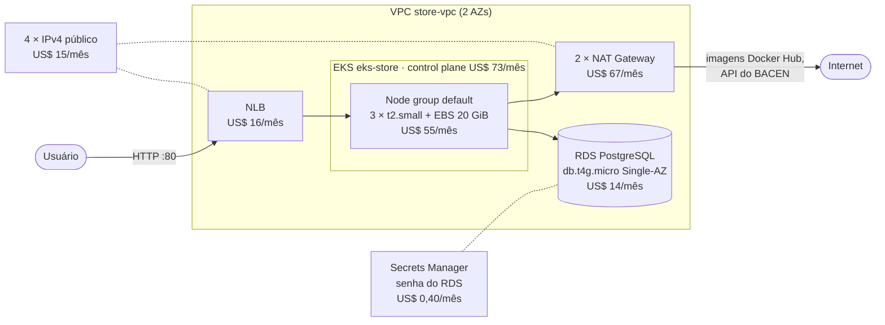
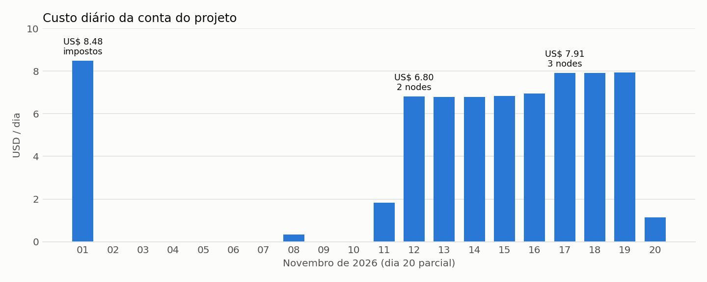
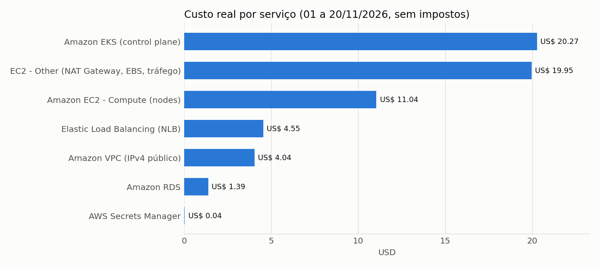
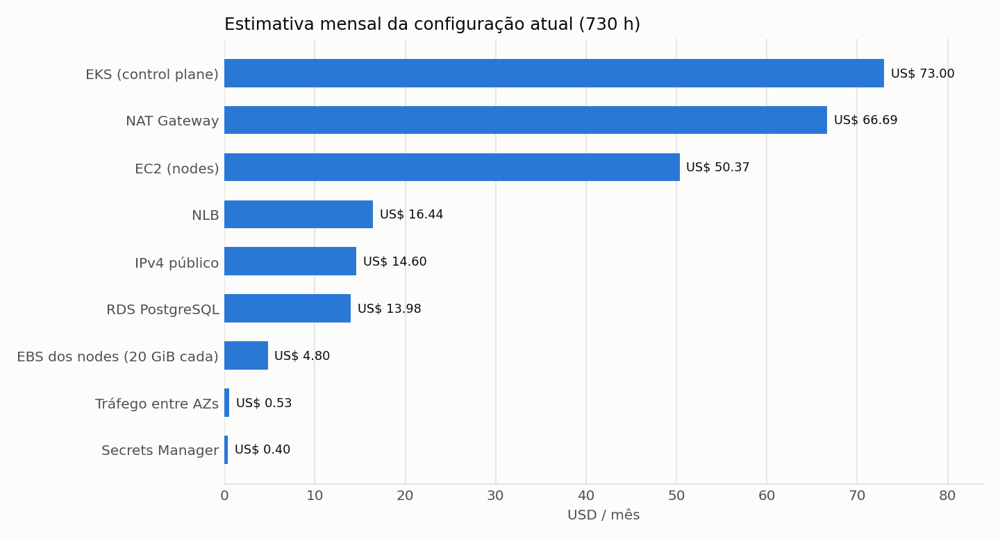
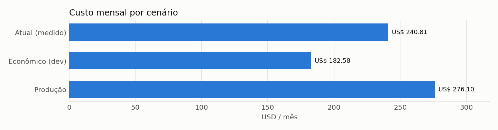

# Custos, PaaS e SLA

???+ info inline end "Ficha"

    **Responsável:** Luca

    **Região:** `us-east-1`

    **Dados extraídos em:** 20/11/2026

Esta seção apresenta o **plano de custos** da plataforma na AWS: quanto ela custou de fato, quanto custa por mês na configuração atual, quais cenários alternativos existem e onde é possível economizar. Ela também descreve onde o grupo usou **PaaS** e qual **disponibilidade (SLA)** a arquitetura consegue oferecer.

Os números vêm de duas fontes:

- **AWS Cost Explorer** da conta do projeto, para o custo real de novembro de 2026;
- **preços públicos on-demand** da AWS, conferidos contra o próprio Cost Explorer (custo cobrado ÷ quantidade usada), para as estimativas.

<div class="grid cards" markdown>

-   :material-cash-check: **Gasto real até 20/11**

    ---

    **US$ 61,28** de uso + US$ 8,48 de impostos = **US$ 69,76**

-   :material-calendar-today: **Custo diário atual**

    ---

    **≈ US$ 7,92/dia** (US$ 0,33/hora) com 3 nodes

-   :material-calendar-month: **Estimativa mensal**

    ---

    **≈ US$ 241/mês** se o ambiente ficar ligado 24×7

-   :material-piggy-bank: **Cenário econômico**

    ---

    **≈ US$ 183/mês** (−24%) com 1 NAT e 2 nodes `t3.small`

</div>

## Arquitetura cobrada

Somente os recursos abaixo geram cobrança. Pods, Services e Deployments do Kubernetes não são cobrados diretamente: o custo está nos nodes EC2 que os executam.


/// caption
Recursos cobrados e custo mensal estimado de cada um, na configuração atual
///

| Recurso | Configuração na conta | Como é cobrado |
|-|-|-|
| EKS `eks-store` | Kubernetes 1.37, suporte padrão | US$ 0,10 por hora de cluster |
| Node group `default` | `t2.small` on-demand, mín. 1 / atual 3 / máx. 10, Cluster Autoscaler | US$ 0,023 por hora de node |
| EBS dos nodes | 20 GiB `gp3` por node | US$ 0,08 por GB-mês |
| NAT Gateway | 2, um por AZ | US$ 0,045 por hora + US$ 0,045 por GB processado |
| NLB | público, 2 AZs, porta 80 → gateway | US$ 0,0225 por hora + US$ 0,006 por NLCU-hora |
| IPv4 público | 2 EIPs dos NATs + 2 IPs do NLB | US$ 0,005 por IP-hora |
| RDS `store-postgres` | PostgreSQL `db.t4g.micro`, Single-AZ, 20 GiB `gp3`, backup de 1 dia | US$ 0,016 por hora + US$ 0,115 por GB-mês |
| Secrets Manager | 1 segredo (senha mestre gerenciada pelo RDS) | US$ 0,40 por segredo-mês |

!!! note "O que **não** gera custo"

    - **Imagens dos containers:** ficam no Docker Hub (`rafaeldbo/*`), então não há ECR. O download passa pelos NAT Gateways, mas o volume é pequeno (6,8 GB em 9 dias, US$ 0,30).
    - **Redis e o PostgreSQL de apoio** rodam como pods dentro do cluster, portanto já estão no custo dos nodes.
    - **Jenkins** roda localmente via Docker Compose, fora da AWS.
    - **Transferência para a internet:** os primeiros 100 GB/mês são gratuitos. O projeto usou 0,4 GB.

## Custo real (Cost Explorer)

O ambiente foi criado em **11/11/2026** e está ligado desde então. Não há créditos aplicados na conta, então todo o valor abaixo é cobrança efetiva.


/// caption
Custo diário de novembro de 2026. O dia 20 está incompleto.
///

Leitura do gráfico:

- **01/11 — US$ 8,48:** lançamento de impostos (*Tax*), que a AWS registra no primeiro dia do mês.
- **08/11 — US$ 0,35:** teste curto antes da criação definitiva do ambiente.
- **11/11:** criação da VPC, dos NAT Gateways, do cluster e do node group (dia parcial).
- **12 a 15/11 — ≈ US$ 6,80/dia:** regime com **2 nodes** (48 horas de node por dia).
- **16/11:** o Cluster Autoscaler sobe um **3º node**, e o RDS é criado na madrugada do dia 17.
- **17 a 19/11 — ≈ US$ 7,92/dia:** regime atual, com **3 nodes** (72 horas de node por dia) e RDS.


/// caption
Custo real acumulado por serviço, de 01 a 20/11/2026
///

??? example "Detalhamento por tipo de uso (01 a 20/11/2026)"

    | Tipo de uso | Quantidade | Custo (US$) | Preço unitário observado |
    |-|-:|-:|-:|
    | `AmazonEKS-Hours:perCluster` | 202,7 h | 20,27 | 0,100/h |
    | `NatGateway-Hours` | 410 h | 18,45 | 0,045/h |
    | `BoxUsage:t2.small` | 479,9 h | 11,04 | 0,023/h |
    | `LoadBalancerUsage` | 202 h | 4,55 | 0,0225/h |
    | `PublicIPv4:InUseAddress` | 808,6 IP-h | 4,04 | 0,005/h |
    | `InstanceUsage:db.t4g.micro` | 72,3 h | 1,16 | 0,016/h |
    | `EBS:VolumeUsage.gp3` | 13,0 GB-mês | 1,04 | 0,080/GB-mês |
    | `NatGateway-Bytes` | 6,8 GB | 0,30 | 0,045/GB |
    | `RDS:GP3-Storage` | 2,0 GB-mês | 0,23 | 0,115/GB-mês |
    | `DataTransfer-Regional-Bytes` | 16,0 GB | 0,16 | 0,010/GB |
    | `AWSSecretsManager-Secrets` | 0,1 segredo-mês | 0,04 | 0,40/mês |
    | `LCUUsage` (NLB) | 0,5 NLCU-h | 0,003 | 0,006/h |
    | **Total de uso** | | **61,28** | |

    Os dados brutos estão em [`dados/cost-explorer-2026-11.json`](dados/cost-explorer-2026-11.json).

!!! warning "Previsão para o resto do mês"

    O Cost Explorer prevê mais **US$ 101,92** até 30/11 se nada for desligado. Somado ao que já foi gasto (US$ 69,76), novembro fecharia em cerca de **US$ 172**.

## Plano de custos

### Estimativa mensal da configuração atual

A estimativa usa **730 horas por mês** (24 h × 365 dias ÷ 12) e os preços unitários da tabela acima. O tráfego (NAT e entre AZs) foi extrapolado a partir dos 9 dias medidos.


/// caption
Custo mensal estimado por componente da configuração atual
///

Três itens concentram **79%** do custo: o **control plane do EKS** (US$ 73), os **dois NAT Gateways** (US$ 67) e os **nodes** (US$ 50). Os dois primeiros são **custos fixos**: são cobrados por hora mesmo sem nenhuma requisição. A carga da aplicação só afeta o número de nodes.

### Cenários

| Componente (US$/mês) | Atual (medido) | Econômico (dev) | Produção |
|-|-:|-:|-:|
| EKS (control plane) | 73,00 | 73,00 | 73,00 |
| EC2 (nodes) | 50,37 | 30,37 | 60,74 |
| EBS dos nodes (20 GiB cada) | 4,80 | 3,20 | 6,40 |
| NAT Gateway | 66,69 | 33,84 | 70,20 |
| NLB | 16,44 | 16,44 | 20,80 |
| IPv4 público | 14,60 | 10,95 | 14,60 |
| RDS PostgreSQL | 13,98 | 13,98 | 27,96 |
| Secrets Manager | 0,40 | 0,40 | 0,40 |
| Tráfego entre AZs | 0,53 | 0,40 | 2,00 |
| **Total / mês** | **240,81** | **182,58** | **276,10** |
| Total / hora | 0,330 | 0,250 | 0,378 |

=== "Atual (medido)"

    Exatamente o que está na conta hoje: 3 nodes `t2.small`, 2 NAT Gateways, NLB e RDS Single-AZ. O valor confere com o medido: US$ 7,92/dia × 30,4 dias ≈ US$ 241.

=== "Econômico (dev)"

    Para desenvolvimento e demonstração:

    - **1 NAT Gateway** em vez de 2. Economiza US$ 32,85 de NAT e US$ 3,65 de IPv4. A desvantagem é que, se a AZ do NAT cair, os nodes da outra AZ perdem acesso à internet.
    - **2 nodes `t3.small`** em vez de 3 `t2.small`. A `t3.small` tem a mesma memória (2 GiB), é mais nova e custa 10% menos por hora.

=== "Produção"

    Para um uso real com tráfego contínuo:

    - **RDS Multi-AZ**: dobra o custo do banco, mas sobe o SLA de 99,5% para 99,95% (ver [SLA](#sla)).
    - **4 nodes `t3.small`** em média, com o autoscaler variando conforme a carga.
    - **100 GB/mês** pelo NAT e **1 NLCU** médio no NLB.


/// caption
Custo mensal total de cada cenário
///

!!! danger "Teto do autoscaler"

    O node group permite até **10 nodes**. Num teste de carga que leve o Cluster Autoscaler ao máximo, os 7 nodes extras custam **US$ 0,18/hora**. Ficar no teto o mês inteiro somaria **US$ 128,73** ao cenário atual (US$ 117,53 de EC2 + US$ 11,20 de EBS), chegando a cerca de **US$ 370/mês**. É por isso que o `maxSize` deve ficar no menor valor que os testes de carga exigirem.

### Calculadora de preços da AWS

A estimativa foi criada na **AWS Pricing Calculator** como *workload estimate* (tipo de taxa *Before discounts*, ou seja, preços on-demand públicos), usando a API da calculadora pela AWS CLI/boto3. Cada item usa o mesmo **tipo de uso** (`usageType`) que aparece no Cost Explorer da conta. Assim, a estimativa modela exatamente os recursos que o projeto paga, e não uma aproximação.

| Estimativa na calculadora | Itens | Total calculado pela AWS |
|-|-:|-:|
| `platform-custos-atual` | 13 | **US$ 240,81 / mês** |
| `platform-custos-producao` | 13 | **US$ 276,10 / mês** |

Os dois totais batem **ao centavo** com a tabela de [cenários](#cenarios), o que confirma os preços unitários usados nesta página.

??? example "Itens da estimativa `platform-custos-atual`"

    | Grupo | Serviço | Tipo de uso | Quantidade / mês | US$ |
    |-|-|-|-:|-:|
    | EKS | AmazonEKS | `USE1-AmazonEKS-Hours:perCluster` | 730 h | 73,00 |
    | Rede | AmazonEC2 | `NatGateway-Hours` | 1.460 h | 65,70 |
    | EKS | AmazonEC2 | `BoxUsage:t2.small` | 2.190 h | 50,37 |
    | Rede | AWSELB | `LoadBalancerUsage` | 730 h | 16,43 |
    | Rede | AmazonVPC | `USE1-PublicIPv4:InUseAddress` | 2.920 h | 14,60 |
    | Banco | AmazonRDS | `InstanceUsage:db.t4g.micro` | 730 h | 11,68 |
    | EKS | AmazonEC2 | `EBS:VolumeUsage.gp3` | 60 GB-mês | 4,80 |
    | Banco | AmazonRDS | `RDS:GP3-Storage` | 20 GB-mês | 2,30 |
    | Rede | AmazonEC2 | `NatGateway-Bytes` | 22 GB | 0,99 |
    | Banco | AWSSecretsManager | `USE1-AWSSecretsManager-Secrets` | 1 segredo | 0,40 |
    | Rede | AWSDataTransfer | `DataTransfer-Regional-Bytes` (entrada + saída) | 53 GB | 0,53 |
    | Rede | AWSELB | `LCUUsage` | 2,2 NLCU-h | 0,01 |
    | | | | **Total** | **240,81** |

    O cenário de produção troca os nodes por `BoxUsage:t3.small` (2.920 h), o banco por `Multi-AZUsage:db.t4g.micro` e `RDS:Multi-AZ-GP3-Storage`, e aumenta o tráfego e as NLCUs.

=== "Script"

    ``` bash
    python scripts/custos/criar_estimativa.py
    ```

    O script ([`scripts/custos/criar_estimativa.py`](https://github.com/organizacao-do-sucesso/platform/blob/main/scripts/custos/criar_estimativa.py){target="_blank"}) cria as duas estimativas e imprime os itens com o custo calculado pela AWS. Cada execução cria estimativas **novas**, então rode só uma vez.

=== "AWS CLI"

    ``` bash
    # 1. Cria a estimativa (preços on-demand)
    aws bcm-pricing-calculator create-workload-estimate \
      --name platform-custos-atual --rate-type BEFORE_DISCOUNTS \
      --region us-east-1 --profile store

    # 2. Adiciona os itens de uso (exemplo com 2 dos 13 itens)
    aws bcm-pricing-calculator batch-create-workload-estimate-usage \
      --workload-estimate-id <ID_DA_ESTIMATIVA> \
      --usage '[
        {"key":"eks","serviceCode":"AmazonEKS","usageType":"USE1-AmazonEKS-Hours:perCluster",
         "operation":"CreateOperation","amount":730,"group":"EKS","usageAccountId":"<ACCOUNT_ID>"},
        {"key":"nodes","serviceCode":"AmazonEC2","usageType":"BoxUsage:t2.small",
         "operation":"RunInstances","amount":2190,"group":"EKS","usageAccountId":"<ACCOUNT_ID>"}]' \
      --region us-east-1 --profile store

    # 3. Consulta o total calculado
    aws bcm-pricing-calculator get-workload-estimate \
      --identifier <ID_DA_ESTIMATIVA> --region us-east-1 --profile store
    ```

=== "Onde ver no console"

    **Billing and Cost Management → Pricing Calculator** (seção *Budgets and planning*) **→ Workload estimates** → `platform-custos-atual`. As estimativas ficam salvas na conta até dezembro de 2027.

## Otimizações

As ações abaixo estão ordenadas pela economia mensal em relação ao cenário atual:

| # | Ação | Economia / mês | Trade-off |
|-|-|-:|-|
| 1 | **Destruir o ambiente quando não estiver em uso** (o guia `k8s/AWS.md` tem a remoção completa) | até US$ 241 | Recriar exige rodar o guia de novo. O ambiente custa US$ 0,33 por hora ligado. |
| 2 | Usar 1 NAT Gateway em vez de 2 | US$ 36,50 | A saída para a internet passa a depender de uma única AZ. |
| 3 | Nodes **Spot** em vez de on-demand | tipicamente > 50% do custo de EC2 | Os nodes podem ser interrompidos com 2 min de aviso. Funciona porque os serviços são *stateless* e o banco está no RDS. |
| 4 | Manter `minSize`/`desiredSize` em 2 fora dos testes de carga | US$ 18,39 (1 node + EBS) | Menos folga para picos até o autoscaler reagir. |
| 5 | Trocar `t2.small` por `t3.small` | US$ 1,61 por node | Nenhum relevante. |
| 6 | Trocar por `t4g.small` (Graviton/ARM) | US$ 4,53 por node | Exige imagens multi-arquitetura (`linux/arm64`) no Docker Hub. |

!!! tip "O que **não** vale a pena"

    - **ECR + VPC endpoints para tirar as imagens do NAT:** cada interface endpoint custa US$ 0,01/hora por AZ, cerca de US$ 14,60/mês por endpoint em 2 AZs. O tráfego de imagens hoje custa US$ 0,30.
    - **Savings Plans / Reserved Instances:** exigem compromisso de 1 a 3 anos, o que não faz sentido para um projeto de um semestre.
    - **O control plane do EKS (US$ 73/mês)** é fixo enquanto o cluster existir. A única forma de eliminá-lo é trocar de orquestrador, por exemplo ECS com Fargate, que não cobra control plane.

## Monitoramento e controle

O acompanhamento foi feito com o **AWS Cost Explorer**, consultado pela AWS CLI:

=== "Custo diário"

    ``` bash
    aws ce get-cost-and-usage \
      --time-period Start=2026-11-01,End=2026-11-21 \
      --granularity DAILY \
      --metrics UnblendedCost \
      --profile store
    ```

=== "Por serviço"

    ``` bash
    aws ce get-cost-and-usage \
      --time-period Start=2026-11-01,End=2026-11-21 \
      --granularity MONTHLY \
      --metrics UnblendedCost \
      --group-by Type=DIMENSION,Key=SERVICE \
      --profile store
    ```

=== "Por tipo de uso"

    ``` bash
    aws ce get-cost-and-usage \
      --time-period Start=2026-11-01,End=2026-11-21 \
      --granularity MONTHLY \
      --metrics UnblendedCost UsageQuantity \
      --group-by Type=DIMENSION,Key=USAGE_TYPE \
      --profile store
    ```

=== "Previsão"

    ``` bash
    aws ce get-cost-forecast \
      --time-period Start=2026-11-21,End=2026-12-01 \
      --granularity MONTHLY \
      --metric UNBLENDED_COST \
      --profile store
    ```

Os gráficos desta página são gerados a partir do snapshot salvo em `docs/custos/dados/`:

``` bash
python scripts/custos/gerar_graficos.py
```

!!! info "AWS Budgets"

    A conta ainda **não tem orçamento configurado**. O recomendado é um budget mensal de custo com alertas por e-mail em 80% (real) e 100% (previsto). Os dois primeiros budgets de uma conta são gratuitos.

    ``` bash
    aws budgets create-budget --account-id <ACCOUNT_ID> \
      --budget '{"BudgetName":"platform-mensal","BudgetLimit":{"Amount":"250","Unit":"USD"},"TimeUnit":"MONTHLY","BudgetType":"COST"}' \
      --notifications-with-subscribers '[
        {"Notification":{"NotificationType":"ACTUAL","ComparisonOperator":"GREATER_THAN","Threshold":80},
         "Subscribers":[{"SubscriptionType":"EMAIL","Address":"<email-do-grupo>"}]},
        {"Notification":{"NotificationType":"FORECASTED","ComparisonOperator":"GREATER_THAN","Threshold":100},
         "Subscribers":[{"SubscriptionType":"EMAIL","Address":"<email-do-grupo>"}]}]' \
      --profile store
    ```

## PaaS

O grupo usou serviços gerenciados para não ter que operar a infraestrutura de base. Isso pesa no custo, porque se paga pela gestão, mas também no esforço de operação:

| Serviço | Modelo | O que a AWS gerencia | O que o grupo gerencia |
|-|-|-|-|
| **Amazon EKS** | PaaS (Kubernetes gerenciado) | Control plane: API server, etcd, scheduler, alta disponibilidade e atualizações | Manifests, node group, autoscaler, HPA |
| **EKS Managed Node Group** | IaaS gerenciado | Provisionamento e substituição das EC2 com a AMI otimizada | Tipo de instância e limites de escala |
| **Amazon RDS for PostgreSQL** | PaaS (DBaaS) | Instalação, patches, backups automáticos, criptografia e senha no Secrets Manager | Schema (Flyway) e dimensionamento |
| **Elastic Load Balancing (NLB)** | PaaS | Balanceamento, health checks e escala do próprio LB | `Service` do tipo `LoadBalancer` via AWS Load Balancer Controller |
| **NAT Gateway** | PaaS de rede | Saída para a internet com alta disponibilidade dentro da AZ | Rotas |
| **AWS Secrets Manager** | PaaS | Armazenamento e rotação da senha mestre do RDS | Leitura da credencial no deploy |
| **Docker Hub / GitHub** | SaaS | Registro de imagens e repositórios | Push das imagens e do código |

!!! example "PaaS × IaaS no custo"

    Um PostgreSQL rodando como pod no cluster não tem custo extra visível, mas não tem backup, alta disponibilidade nem patches. O RDS custa US$ 14/mês e entrega tudo isso. O mesmo raciocínio vale para o EKS: os US$ 73/mês do control plane substituem pelo menos 3 VMs de control plane que o grupo teria que instalar, atualizar e manter disponíveis com kubeadm.

## SLA

O SLA de cada serviço, segundo as páginas oficiais da AWS, consultadas em 20/11/2026:

| Serviço | Escopo | SLA mensal |
|-|-|-:|
| Elastic Load Balancing | LB em 2 ou mais AZs (nosso NLB) | 99,99% |
| Amazon EC2 | Região: instâncias em 2 ou mais AZs | 99,99% |
| Amazon EC2 | Uma única instância | 99,5% |
| Amazon EKS | Endpoint do control plane (padrão) | 99,95% |
| Amazon RDS | Single-AZ (nossa configuração) | 99,5% |
| Amazon RDS | Multi-AZ | 99,95% |
| NAT Gateway | Por NAT Gateway | 99,9% |

Uma requisição comum passa em série por **NLB → nodes EC2 → RDS**, então o SLA composto é o produto dos SLAs:

$$
SLA_{atual} = 0{,}9999_{\text{NLB}} \times 0{,}9999_{\text{EC2}} \times 0{,}995_{\text{RDS}} \approx 99{,}48\%
$$

Isso equivale a até **≈ 3,8 h de indisponibilidade por mês**. O RDS Single-AZ é claramente o elo fraco:

| Configuração | SLA composto | Indisponibilidade máx. / mês | Custo / mês |
|-|-:|-:|-:|
| Atual (RDS Single-AZ) | 99,48% | ≈ 3 h 48 min | US$ 241 |
| Atual, rota do `exchange` (inclui NAT para a API do BACEN) | 99,38% | ≈ 4 h 31 min | US$ 241 |
| Produção (RDS Multi-AZ) | 99,93% | ≈ 31 min | US$ 276 |

Por cerca de **US$ 14/mês a mais**, o RDS Multi-AZ reduz a indisponibilidade máxima de quase 4 horas para cerca de meia hora.

!!! note "Premissas do cálculo"

    - **O EKS fica fora do produto.** Se o control plane cair, os pods que já estão rodando continuam atendendo. O que para são deploys, escala e reagendamento.
    - **O SLA regional de 99,99% do EC2** vale para o conjunto de instâncias distribuídas nas 2 AZs. Para valer de fato para a aplicação, cada serviço precisa de **pelo menos 2 réplicas em AZs diferentes**. Com 1 réplica, a falha de um node derruba o serviço até o pod ser reagendado.
    - SLA é um compromisso contratual de crédito, não uma garantia técnica. Ele não cobre falhas da própria aplicação.

## Uso de IA

O levantamento dos dados (consultas ao Cost Explorer e ao estado dos recursos pela AWS CLI), a criação das estimativas na Pricing Calculator via API, os scripts e o rascunho desta página foram feitos com auxílio do Claude (Anthropic). Os números foram conferidos contra o Cost Explorer, e os SLAs contra as páginas oficiais da AWS. O texto foi revisado pelo autor.

## Referências

- [AWS Cost Explorer](https://aws.amazon.com/aws-cost-management/aws-cost-explorer/){target="_blank"}
- [AWS Budgets](https://aws.amazon.com/aws-cost-management/aws-budgets/){target="_blank"}
- [AWS Pricing Calculator](https://docs.aws.amazon.com/cost-management/latest/userguide/pricing-calculator.html){target="_blank"} e [API `bcm-pricing-calculator`](https://docs.aws.amazon.com/botocore/latest/reference/services/bcm-pricing-calculator.html){target="_blank"}
- Preços: [EKS](https://aws.amazon.com/eks/pricing/){target="_blank"}, [EC2](https://aws.amazon.com/ec2/pricing/on-demand/){target="_blank"}, [RDS PostgreSQL](https://aws.amazon.com/rds/postgresql/pricing/){target="_blank"}, [VPC/NAT/IPv4](https://aws.amazon.com/vpc/pricing/){target="_blank"}, [ELB](https://aws.amazon.com/elasticloadbalancing/pricing/){target="_blank"}
- SLAs: [EKS](https://aws.amazon.com/eks/sla/){target="_blank"}, [EC2](https://aws.amazon.com/compute/sla/){target="_blank"}, [RDS](https://aws.amazon.com/rds/sla/){target="_blank"}, [ELB](https://aws.amazon.com/elasticloadbalancing/sla/){target="_blank"}, [VPC/NAT](https://aws.amazon.com/vpc/sla/){target="_blank"}
